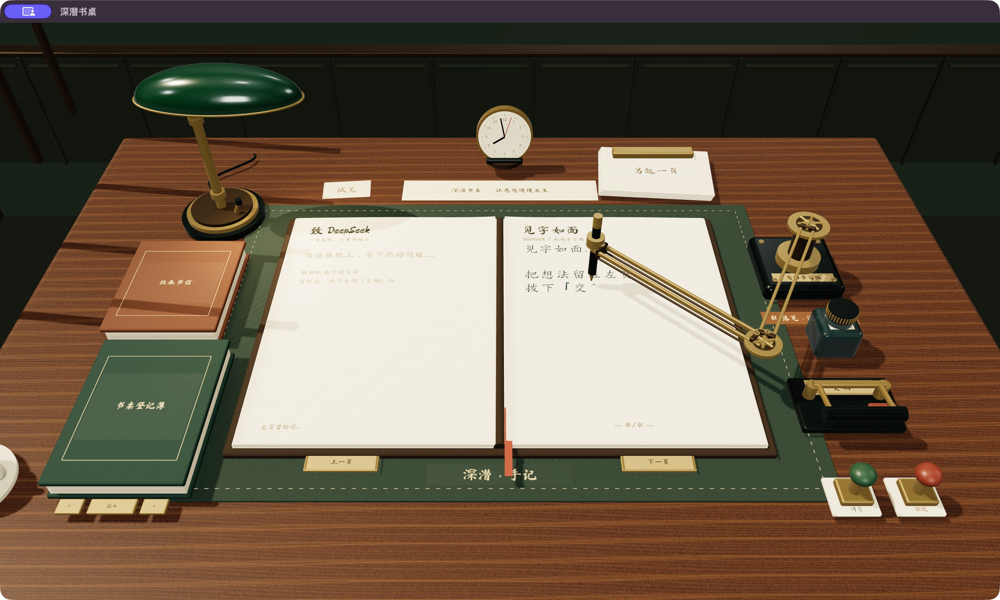

# Skeuomo-DSH · 深潜书桌

English | [中文](README.zh.md)

A desk for thinking with an AI: leave a question on the left page and watch a brass writing arm put the reply on paper, stroke by stroke.



Skeuomo-DSH is an independent interface project built on [DeepSeek Harness](https://github.com/deepseek-ai/deepseek-harness). Three.js renders the desk, lighting, paper, and mechanical pen; Harness supplies real sessions, model streaming, credentials, and tool execution. The desk controls and handwriting prompts are currently in Chinese.

We built this Harness as a tribute to [DEsk](https://github.com/fyzugx/DEsk), a Linux desktop environment that takes skeuomorphism all the way.

This Harness is pretty damn useless and painfully inefficient. But it is skeuomorphic, and it looks great. You're welcome to try it; just don't expect it to be particularly practical.

## At the desk

- **Write and receive.** Type on the left page, press the delivery lever or Cmd/Ctrl+Enter, and read the reply on the right. Chinese characters follow local stroke data; Latin letters follow hand-drawn paths.
- **Move closer.** Writing and incoming replies bring the notebook into view. Escape returns to the seated perspective; the wheel adjusts distance.
- **Keep your correspondence.** Open earlier sessions from the correspondence book, turn manuscript pages with the brass tabs, and start a session from the spare paper stack.
- **Use the objects.** The lamp switch changes the light; the pen base changes writing speed; the stop key cancels the request. The trial slip demonstrates handwriting without a model call.
- **Configure and approve.** The desk register accepts a DeepSeek API key, working directory, and model selection. Permission requests appear on paper with approval stamps; question slips accept one answer per line.

See the [desk guide](scripts/study-macos/README.md) for all controls and the macOS launcher.

<a id="run"></a>

<a id="run-from-source"></a>

## Quick start

You need Git, Node.js **22.19+ in the 22.x series, or 24+**, pnpm **11.28.5** as pinned in `package.json`, and a browser with WebGL 2 and hardware acceleration. A DeepSeek API key is required for online replies; the trial slip works without one.

```sh
git clone https://github.com/ZiyueW1116/skeuomo-dsh.git
cd skeuomo-dsh
pnpm install --frozen-lockfile
pnpm run build
pnpm dsh web
```

Open the local URL printed by the command if your browser does not open automatically. The default address is `http://127.0.0.1:3080`. Open the green desk register, enter your key, use Tab to enter a working directory, select a model with the tabs, then press the save clasp. Stop the server with Ctrl+C.

This interface is distributed as source in this repository. The upstream `npx @deepseek-ai/dsh web` package runs the upstream product.

### macOS window

With macOS 13+ and Xcode Command Line Tools installed, build the native WebKit wrapper after the commands above:

```sh
python3 scripts/study-macos/build.py
open ../深潜书桌.app
```

The wrapper starts its own loopback Harness server and stops it when the window closes. It depends on the checkout and Node.js at their build-time paths; rebuild after moving either. The local app is ad-hoc signed and is not Apple-notarized.

## Data and current limits

The desk uses Harness's `~/.dsh` Web profile and shares its session and credential stores. Web and Desktop model configuration are separate. The scene and fonts load locally; online conversations send requests to the configured model provider. Review the [Harness safety notice](SAFETY.md) before allowing tool execution against a working directory.

This is an experimental desktop-oriented interface. It displays text as handwriting, including Markdown source; it does not provide the upstream rich tool cards, attachment workflow, plugin panels, or complete settings UI. Traditional sidebar and overlay contributions are not mounted. Small screens and touch input are not the primary target. Windows and Linux can use the browser build, but the native wrapper is macOS-only.

## Development

The [development guide](docs/development.md) covers the monorepo; [AGENTS.md](AGENTS.md) records repository conventions. The main project files are:

| Location | Responsibility |
| --- | --- |
| [`packages/client/ui-chat/src/client/study/`](packages/client/ui-chat/src/client/study/) | Scene, handwriting, paper surfaces, and session interaction |
| [`packages/client/ui-layout/`](packages/client/ui-layout/) | Full-window desk composition |
| [`apps/web/public/study/`](apps/web/public/study/) | Local font, stroke data, and material assets |
| [`scripts/study-macos/`](scripts/study-macos/) | Native window and local app builder |
| [`apps/web/tests/study-desk.e2e.ts`](apps/web/tests/study-desk.e2e.ts) | Browser interaction and replayed conversation checks |

```sh
pnpm run build
pnpm run test:gui
pnpm exec vitest run --config vitest.web.config.ts apps/web/tests/study-desk.e2e.ts
pnpm exec vitest run --config vitest.web.perf.config.ts apps/web/tests/study-render.perf.ts
```

The desk browser tests replay model responses through the real Harness conversation stream and require no API key. The performance diagnostic prints frame timing and heap measurements for the current machine; it does not establish a cross-device performance guarantee. Use [this repository's issues](https://github.com/ZiyueW1116/skeuomo-dsh/issues) for desk-specific bugs and contributions.

## Credits and license

[DeepSeek Harness](https://github.com/deepseek-ai/deepseek-harness) by DeepSeek AI provides the agent runtime and plugin architecture, powered by [Cordis](https://github.com/cordiverse/cordis). [DEsk](https://github.com/fyzugx/DEsk) is the visual reference for the study; this project's scene models are generated in code. This repository is maintained independently of DeepSeek AI.

Code is released under [MIT](LICENSE), retaining upstream copyright notices. Fonts, stroke data, and material assets retain their own licenses; see [study asset credits](apps/web/public/study/CREDITS.md) and [third-party software notices](THIRD_PARTY_NOTICES.md).
