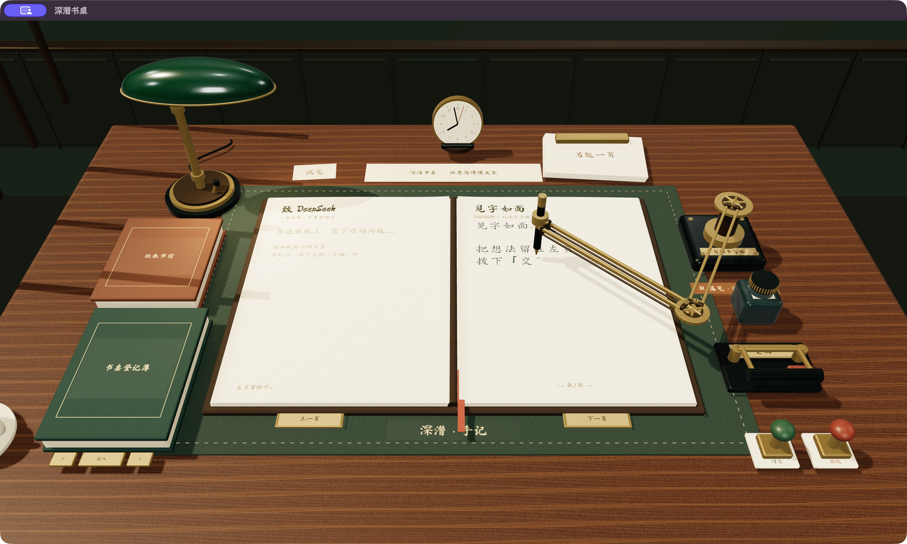

# Skeuomo-DSH · 深潜书桌

[English](README.md) | 中文

给思考留一张书桌：把问题写在左页，看黄铜机械臂在右页一笔一画地写下回信。



Skeuomo-DSH 是基于 [DeepSeek Harness](https://github.com/deepseek-ai/deepseek-harness) 开发的独立界面项目。Three.js 绘制书桌、灯光、纸张和机械笔；Harness 提供真实会话、模型流式回复、凭据管理和工具执行。书桌控件与手写提示目前使用中文。

我们做这个 Harness，是为了致敬 [DEsk](https://github.com/fyzugx/DEsk)：一个追求彻底拟物化的 Linux 桌面环境。

这个 Harness 其实屁用都没有，而且效率奇低。但它确实是一个拟物的 Harness，而且很好看。欢迎试用它，但请不要指望它真的很实用。

## 在书桌前

- **写信与收信。** 轻触左页输入，按下交稿杆或 Cmd/Ctrl+Enter，右页逐笔呈现回信。中文沿本地笔顺落墨，拉丁字母沿手绘轨迹书写。
- **靠近手稿。** 输入和收到回信时自动俯身阅读；Esc 恢复坐姿，滚轮调整距离。
- **留下往来。** 在往来书信簿中打开历史会话，用黄铜拨片翻阅长手稿，从备用信纸中新建会话。
- **触碰物件。** 台灯开关调节照明，书写仪底座切换笔速，「停」键中止请求。「试笔」无需调用模型即可演示手写。
- **登记与签批。** 在登记簿中填写 DeepSeek API Key、工作目录并选择模型。授权请求显示为签批纸，使用印章作出决定；问笺在左页逐行作答。

全部操作及 macOS 启动方式见[书桌指南](scripts/study-macos/README.zh.md)。

<a id="run"></a>

<a id="run-from-source"></a>

## 快速开始

需要 Git、Node.js **22.x 且至少 22.19，或 24 及以上版本**、`package.json` 固定的 pnpm **11.28.5**，以及支持 WebGL 2 和硬件加速的浏览器。在线回信需要 DeepSeek API Key；试笔无需凭据。

```sh
git clone https://github.com/ZiyueW1116/skeuomo-dsh.git
cd skeuomo-dsh
pnpm install --frozen-lockfile
pnpm run build
pnpm dsh web
```

若浏览器没有自动打开，访问命令打印的本地链接，默认地址为 `http://127.0.0.1:3080`。翻开绿色登记簿，填写 Key，按 Tab 填写工作目录，用拨片选择模型，再按铜扣保存。终端按 Ctrl+C 停止服务。

书桌界面以本仓库源码分发。上游 `npx @deepseek-ai/dsh web` 软件包运行的是上游产品。

### macOS 窗口

在 macOS 13 及以上系统安装 Xcode Command Line Tools，完成上述构建后生成原生 WebKit 窗口：

```sh
python3 scripts/study-macos/build.py
open ../深潜书桌.app
```

窗口启动自己的本地 Harness 服务，关闭窗口时结束该服务。应用依赖构建时的源码目录和 Node.js 路径，移动后需要重新构建。应用使用本机开发签名，未经 Apple 公证。

## 数据与当前限制

书桌使用 Harness 的 `~/.dsh` Web profile，共享会话与凭据库。Web 和 Desktop 的模型配置彼此独立。场景和字体从本地加载；在线对话会向配置的模型服务商发出请求。在允许工具操作工作目录前，请阅读 [Harness 安全说明](SAFETY.zh.md)。

这是面向桌面设备的实验界面。正文以手写文本显示，Markdown 标记也按原文书写；上游的富工具卡片、附件操作、插件面板和完整设置界面尚未接入书桌。传统侧栏与悬浮层不挂载。小屏幕与触摸操作并非主要适配目标。Windows 和 Linux 可使用浏览器构建，原生窗口仅支持 macOS。

## 开发

Monorepo 的使用方式见[开发指南](docs/development.zh.md)，仓库约定见 [AGENTS.md](AGENTS.md)。本项目的主要文件如下：

| 位置 | 职责 |
| --- | --- |
| [`packages/client/ui-chat/src/client/study/`](packages/client/ui-chat/src/client/study/) | 场景、笔顺、纸面和会话交互 |
| [`packages/client/ui-layout/`](packages/client/ui-layout/) | 全窗口书桌组合 |
| [`apps/web/public/study/`](apps/web/public/study/) | 本地字体、笔顺和材质资源 |
| [`scripts/study-macos/`](scripts/study-macos/) | 原生窗口与本机应用构建 |
| [`apps/web/tests/study-desk.e2e.ts`](apps/web/tests/study-desk.e2e.ts) | 浏览器交互与会话回放验证 |

```sh
pnpm run build
pnpm run test:gui
pnpm exec vitest run --config vitest.web.config.ts apps/web/tests/study-desk.e2e.ts
pnpm exec vitest run --config vitest.web.perf.config.ts apps/web/tests/study-render.perf.ts
```

书桌浏览器测试通过真实 Harness 会话流回放模型回复，无需 API Key。性能诊断输出当前机器的帧间隔和堆内存测量，不代表所有设备的性能保证。书桌相关的问题与贡献请提交到[本仓库 Issues](https://github.com/ZiyueW1116/skeuomo-dsh/issues)。

## 致谢与许可证

DeepSeek AI 的 [DeepSeek Harness](https://github.com/deepseek-ai/deepseek-harness) 提供智能体运行时与插件架构，底层由 [Cordis](https://github.com/cordiverse/cordis) 驱动。[DEsk](https://github.com/fyzugx/DEsk) 是书房视觉参考，本项目的场景模型由代码生成。本仓库由独立维护者维护。

代码采用 [MIT](LICENSE) 许可证，保留上游版权声明。字体、笔顺和材质资源遵循各自许可证，见[书桌资源署名](apps/web/public/study/CREDITS.md)与[第三方软件声明](THIRD_PARTY_NOTICES.md)。
